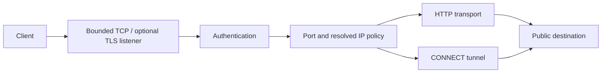

# Architecture

`cmd/proxy` validates JSON, secret material and certificates, bounds client sockets, and handles signals. `internal/proxy` implements authentication, destination policy, forwarding and tunnel lifecycle. There is no database, client application, Rust service or exit-node network.

HTTP requires absolute http URLs. Context and client I/O deadlines bound streaming. The transport ignores environment proxy settings. Hop-by-hop and common identity headers are stripped; origin Authorization is preserved. Responses stream with bounded buffers. HTTP Upgrade is unsupported.

CONNECT requires HTTP/1, an explicit allowed port and no body. The checked public address is dialed, then two copy loops relay bytes, preserving already-buffered client data. Absolute deadlines bound tunnel lifetime; shutdown closes tracked client and upstream connections. Origin TLS remains end-to-end.

DNS answers are validated as a set, then dialed as literal IPs. Policy denial returns 403, authentication failure 407, upstream failure 502, capacity/shutdown 503. Upstream error details are not exposed to clients. Socket limits include unauthenticated, TLS-handshake, idle and tunnel clients. Host/container resource budgets remain necessary.
